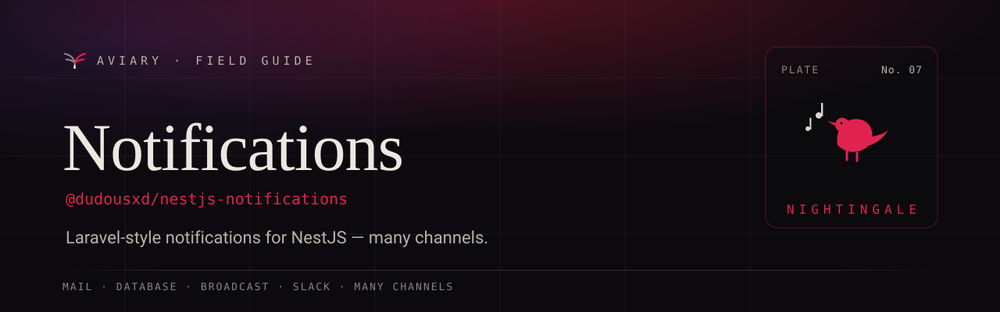

<p align="center">
  <a href="https://davidecarvalho.github.io/aviary/docs/notifications">
    
  </a>
</p>

<p align="center">
  <b><a href="https://davidecarvalho.github.io/aviary/docs/notifications">📖 Read the documentation</a></b>
  &nbsp;·&nbsp; part of the <a href="https://davidecarvalho.github.io/aviary/"><b>Aviary</b></a> ecosystem for NestJS
</p>

---

# nestjs-notifications

Laravel-style notifications for NestJS. Define a notification once and send it across many
channels — mail, database, broadcast, Slack — synchronously or through a pluggable async
dispatcher (in-process events, Redis, or your app's existing BullMQ setup).

📚 **Documentation: https://davidecarvalho.github.io/nestjs-notifications/**

```ts
class InvoicePaid implements Notification, MailNotification, DatabaseNotification {
  constructor(private invoice: Invoice) {}
  via() { return ['mail', 'database']; }
  toMail() { return new MailMessage().subject('Paid!').line('Thanks for your payment.'); }
  toDatabase() { return { invoiceId: this.invoice.id }; }
}

await notifications.send(user, new InvoicePaid(invoice));
```

## Why

- **Faithful to Laravel** — `send`, `via`, `toMail`, on-demand routing, queued notifications.
- **Decoupled core** — the core knows only interfaces; every channel and dispatcher is an
  opt-in package.
- **Type-safe payloads** — each channel exports an interface your notification implements,
  so `toMail`/`toDatabase`/`toSlack` are checked at compile time.
- **Observable** — lifecycle events plus a first-class [nestjs-telescope](https://github.com/DavideCarvalho/nestjs-telescope) watcher.

## Packages

| Package | What it does |
| --- | --- |
| `@dudousxd/nestjs-notifications-core` | Abstractions, `NotificationService`, synchronous dispatcher, events; `/outbox` transactional dispatch on `@nestjs/outbox`, `/i18n` translator on `@nestjs/i18n` |
| `@dudousxd/nestjs-notifications-mail` | Mail channel on `@nestjs/mail` — fluent `MailMessage`; Default/Markdown/React-Email/MJML renderers; per-tenant transport routing |
| `@dudousxd/nestjs-notifications-database` | Database channel — `NotificationStore` + in-memory store |
| `@dudousxd/nestjs-notifications-database-typeorm` | TypeORM adapter for the database channel |
| `@dudousxd/nestjs-notifications-database-mikro-orm` | MikroORM adapter for the database channel |
| `@dudousxd/nestjs-notifications-database-prisma` | Prisma adapter for the database channel |
| `@dudousxd/nestjs-notifications-database-drizzle` | Drizzle ORM (Postgres) adapter for the database channel + digest store (`@nestjs/drizzle` connections) |
| `@dudousxd/nestjs-notifications-broadcast` | WebSocket (socket.io) channel for realtime in-app notifications |
| `@dudousxd/nestjs-notifications-sse` | Server-Sent Events channel for live in-app updates |
| `@dudousxd/nestjs-notifications-push` | Push channel — Web Push, FCM, Expo, APNs |
| `@dudousxd/nestjs-notifications-sms` | SMS channel — Twilio, Vonage, AWS SNS |
| `@dudousxd/nestjs-notifications-slack` | Slack channel — webhook or bot token |
| `@dudousxd/nestjs-notifications-discord` | Discord channel — webhook |
| `@dudousxd/nestjs-notifications-telegram` | Telegram channel — Bot API |
| `@dudousxd/nestjs-notifications-teams` | Microsoft Teams channel — incoming webhook |
| `@dudousxd/nestjs-notifications-webhook` | Webhook channel on `@nestjs/webhooks` — signed POSTs (sha256 or Standard Webhooks) or subscription fan-out |
| `@dudousxd/nestjs-notifications-preferences` | Channel opt-out + full preference center (category × channel × digest) |
| `@dudousxd/nestjs-notifications-delivery-tracking` | Persisted per-channel delivery status + Twilio/SES inbound status webhooks; `/mail` records `@nestjs/mail` events |
| `@dudousxd/nestjs-notifications-resilience` | Provider failover on `@nestjs/resilience` circuit breakers + timeouts |
| `@dudousxd/nestjs-notifications-client` | Framework-neutral headless SDK — fetch client + SSE subscribe + TanStack Query factories |
| `@dudousxd/nestjs-notifications-react` | Drop-in `<Inbox/>` widget + `useNotifications` / `useUnreadCount` hooks |
| `@dudousxd/nestjs-notifications-event-emitter` | In-process async dispatch via `@nestjs/event-emitter` |
| `@dudousxd/nestjs-notifications-bullmq` | Async dispatch reusing your app's BullMQ |
| `@dudousxd/nestjs-notifications-redis` | Async dispatch via Redis for a dedicated worker |
| `@dudousxd/nestjs-notifications-telescope` | nestjs-telescope watcher — see every send in the dashboard |
| `@dudousxd/nestjs-notifications-testing` | `NotificationFake` + Laravel-style assertions |

## Install

```bash
pnpm add @dudousxd/nestjs-notifications-core @dudousxd/nestjs-notifications-mail @nestjs/mail @nestjs/event-emitter
```

## Quick start

Where NestJS ships a first-party package (mail, webhooks, outbox, i18n, Drizzle, resilience), Aviary
builds on it. Upgrading from an earlier 0.x? See the
[migration guide](website/content/docs/reference/migrating-to-nestjs-first-party.mdx).

```ts
@Module({
  imports: [
    EventEmitterModule.forRoot(),
    NotificationsModule.forRoot({ notifications: [InvoicePaid] }),
    MailModule.forRoot({
      transport: new SmtpTransport({ host: 'smtp.example.com', port: 587, auth: { user, pass } }),
      from: 'billing@example.com',
    }),
    MailChannelModule.forRoot(),
    DatabaseChannelModule.forRoot(), // in-memory; pair with an ORM adapter for persistence
  ],
})
export class AppModule {}
```

```ts
@Injectable()
class BillingService {
  constructor(private readonly notifications: NotificationService) {}

  async paid(user: User, invoice: Invoice) {
    await this.notifications.send(user, new InvoicePaid(invoice));
    // on-demand, no Notifiable entity:
    await this.notifications.route('mail', 'ops@example.com').notify(new InvoicePaid(invoice));
  }
}
```

A recipient implements `Notifiable`:

```ts
class User implements Notifiable {
  constructor(public id: number, public email: string) {}
  routeNotificationFor(channel: string) {
    return channel === 'mail' ? this.email : undefined;
  }
  toNotifiableRef() { return { type: 'User', id: this.id }; } // needed for async dispatch
}
```

## Two orthogonal abstractions

1. **Channel drivers** — *how* a notification leaves (mail, database, broadcast, slack).
2. **Dispatch drivers** — *where/when* it is processed (sync inline, in-process events,
   Redis, BullMQ).

They are independent: you can send by mail (channel) asynchronously through BullMQ (dispatch).

### Async delivery

Set `shouldQueue` on the notification and choose a dispatcher:

```ts
NotificationsModule.forRoot({
  ...bullmqDispatcher(),                 // from @dudousxd/nestjs-notifications-bullmq
  imports: [/* BullModule.forRoot(...) */],
  notifications: [InvoicePaid],          // registry used to rehydrate in the worker
  resolveNotifiable: (ref) => userRepo.findOneBy({ id: Number(ref.id) }),
});
```

The notification is serialized as `{ name, data }`; the notifiable as a `{ type, id }`
reference rebuilt by `resolveNotifiable`. The synchronous path needs none of this.

## Telescope integration

```ts
TelescopeModule.forRoot({ watchers: [new NotificationsWatcher()] });
```

Every `notification.sent` / `notification.failed` shows up as a `notification` entry —
channel, recipient, notification class, payload, and failure reason.

## Authorization of the mounted routes

The library has no access-control options of its own: you decide who reaches its routes with
NestJS's first-party [`@nestjs/authentication`](https://docs.nestjs.com/security/authentication)
and [`@nestjs/authorization`](https://docs.nestjs.com/security/authorization), in one of two ways.

1. **`decorators`** — the inbox (`DatabaseChannelModule.forRoot/forFeature`,
   `createNotificationsController`), the SSE stream (`createNotificationsStreamController`), the
   preference center (`createPreferenceCenterController`) and the delivery-tracking callbacks
   (`createTwilioStatusController`, `createSesNotificationController`) all take
   `decorators?: ClassDecorator[]`, applied in order to the controller:

   ```ts
   DatabaseChannelModule.forRoot({
     decorators: [UseGuards(AuthenticationGuard), Can(InboxPolicy, 'read')],
   });
   ```

2. **Mount the controller yourself** — the factories return a controller class you add to your
   own module's `controllers`. For the inbox, pass `routes: false` to `DatabaseChannelModule` so it
   doesn't auto-mount a second one.

Every controller is marked open to `@nestjs/authorization`'s deny-by-default global guard (the
metadata `Can.Anyone()` writes), so adopting it does not lock them; a `@Can()` passed in
`decorators` is still enforced. Each registration builds a fresh controller class, so decorators
never leak between registrations.

**Production.** Nothing refuses to boot. The inbox, SSE and preference routes are scoped to the
recipient `resolveRef`/`resolveRoute` returns (the auto-mounted inbox's default resolver answers
`401` with no `req.user.id`). Delivery-tracking callbacks are called by providers, which carry no
user, so they are outside any "must be decorated" rule: Twilio is verified by `X-Twilio-Signature`,
and SES by the SNS message signature plus a required `topicArns` allowlist and a timestamp check
(`403` otherwise).

**Migrating from `guards`** (removed): `guards: [G]` → `decorators: [UseGuards(G)]`, or mount the
controller yourself; `controller: false` → `routes: false`.

## Testing

```ts
const fake = new NotificationFake();
// ...override NotificationService with the fake...
fake.assertSentTo(user, InvoicePaid);
fake.assertSentOnChannel('mail');
```

## Development

```bash
pnpm install
pnpm build        # turbo, topological
pnpm test         # vitest across all packages
pnpm lint         # biome
```

See [`docs/plans`](./docs/plans) for the design document and [`examples/basic`](./examples/basic)
for a runnable end-to-end app.

## License

MIT © Davide Carvalho
